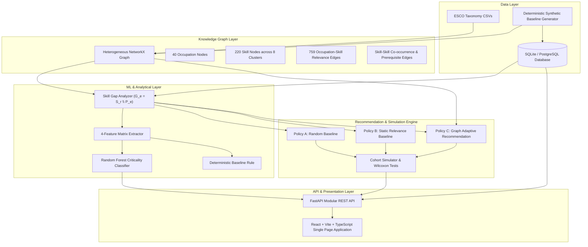

# ASGP System Architecture & ML Pipeline Specification

## 1. System Overview

The **Adaptive Skill Gap Predictor (ASGP)** is an end-to-end machine learning and knowledge-graph-driven decision support platform designed to optimize post-recruitment employee onboarding and training pathways.

---

## 2. Knowledge Graph Schema

The core knowledge representation is a heterogeneous attributed directed graph $\mathcal{G} = (\mathcal{V}, \mathcal{E}, \mathcal{W})$:

1. **Vertex Sets $\mathcal{V} = \mathcal{V}_{occ} \cup \mathcal{V}_{skl}$:**
   - $\mathcal{V}_{occ}$: 40 occupation concepts with primary/secondary latent cluster tags.
   - $\mathcal{V}_{skl}$: 220 skill concepts partitioned across 8 latent functional clusters, including 26 (~12%) generic/cross-cutting competencies.
2. **Edge Sets $\mathcal{E}$:**
   - **Bipartite Requirement Edges $(o, s) \in \mathcal{E}_{req}$:** Directed edges indicating that occupation $o$ requires skill $s$ with weight $w_{o,s} \in [0.45, 0.98]$ and relation type $\in \{\text{essential}, \text{optional}\}$.
   - **Reciprocal Support Edges $(s, o) \in \mathcal{E}_{sup}$:** Enables rapid inverse lookup of occupation demand from skill profiles.
   - **Intra-cluster Affinity Edges $(s_i, s_j) \in \mathcal{E}_{rel}$:** Connects conceptually related skills within identical clusters ($w=0.65$).
   - **Prerequisite Edges $(s_p, s_t) \in \mathcal{E}_{pre}$:** Directed constraints indicating skill $s_p$ is a prerequisite for skill $s_t$.

---

## 3. Skill-Gap & Feature Extraction Pipeline

For employee $e$ assigned to occupation $r$, the gap is formulated as:

$$G_e = S_r \setminus P_e$$

where $S_r = \{s \in \mathcal{V}_{skl} \mid (r, s) \in \mathcal{E}_{req}\}$ and $P_e = \{s \in \mathcal{V}_{skl} \mid \text{state}(e, s) = \text{mastered}\}$.

For each missing skill $s \in G_e$, the 4-dimensional feature vector $\mathbf{x}_{e,s} \in \mathbb{R}^4$ is extracted:
1. $x_1 = w_{r,s}$ (Occupation relevance weight).
2. $x_2 = g_s \in \{0, 1\}$ (Generic skill indicator).
3. $x_3 = |P_e|$ (Count of mastered skills possessed by employee).
4. $x_4 = \frac{|P_e \cap S_r \cap \mathcal{C}(s)|}{|S_r \cap \mathcal{C}(s)|}$ (Employee coverage of the skill's cluster).

---

## 4. Recommendation Policies & Formulation

- **Policy A (Random):** $s^* \sim \text{Uniform}(G_e)$.
- **Policy B (Static Relevance):** $s^* = \arg\max_{s \in G_e} w_{r,s}$ based on fixed initial ranking.
- **Policy C (Adaptive Graph-Informed):**
  $$s^* = \arg\max_{s \in G_e} \left[ \alpha \cdot w_{r,s} + \beta \cdot \text{ClusterBonus}(s, P_e) + \gamma \cdot \text{PrereqBonus}(s, P_e) \right]$$
  Default parameters: $\alpha = 1.0, \beta = 0.35, \gamma = 0.25$.

---

## 5. Role Readiness Metric & Evaluation Protocol

Readiness is computed continuously after every assessment step:

$$\text{Readiness}(e) = \frac{\sum_{s \in P_e \cap S_r} w_{r,s}}{\sum_{s \in S_r} w_{r,s}}$$

- **Target Threshold:** 80% ($\ge 0.80$).
- **Budget:** 50 steps before censoring.
- **Statistical Tests:** Paired Wilcoxon Signed-Rank tests with Cohen's $d$ effect sizes across identical starting profiles.
